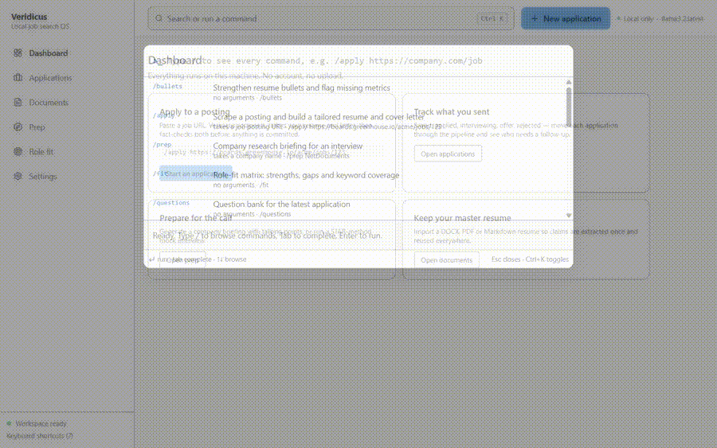

# Veridicus

[](https://github.com/RadioMan18/veridicus/actions/workflows/ci.yml)

Privacy-first job search OS with honesty guardrails. Veridicus is a Tauri 2 desktop application (Rust + React + TypeScript) that runs the whole application workflow — scrape a posting, tailor a resume and cover letter, compile PDFs, practice the interview, follow up — while only ever stating facts the candidate has verified.

Every generated sentence is grounded in a **Claims Ledger** of confirmed facts; a model that invents, pads or contradicts the ledger is rejected and retried rather than shipped. All inference is local through Ollama, so resumes and job descriptions never leave the machine.

## Demo



`/bullets` drafts a stronger version of each resume bullet from your confirmed claims, then re-checks the draft before showing it. In the clip the first bullet keeps a 47% figure that nothing in the ledger supports, so it is blocked and the offending number is named; the second is grounded and comes back rewritten. The same run is in [docs/demo/bullets-review.png](docs/demo/bullets-review.png) as a still, and as [an MP4](docs/demo/bullets-demo.mp4).

The model's draft in this recording comes from the checked-in fixture `src-tauri/eval/demo-bullets.json` rather than a live local model, so the result is reproducible; the classifiers that block and accept the bullets are the ordinary ones, and the fixture still goes through every one of them.

## Features

### Honesty guardrails

- **Claims Ledger** — confirmed facts with evidence, stored in a SQLCipher-encrypted SQLite database. Generated documents may only use what is in the ledger.
- **Gap analysis** — every posting against your ledger, with per-gap status so you can decide what is genuinely missing instead of inflating a bullet.
- **Grounding checks** — a document that cites a claim you have not confirmed, echoes the prompt, or leaves a `[fill in]` marker is sent back once and then refused.
- **Required gaps in letters** — a cover letter must name the requirement it does not meet, with the adjacent strength, instead of implying experience you lack.
- **Audit record** — every block, override and advisory finding is recorded. `/honesty-stats` summarises them; the incident log can be exported for review.
- **AI disclosure tracking** — explicit acknowledgement of where AI produced text.

### Apply workflow

`/apply <url>` runs a staged, cancellable pipeline:

1. Scrape the posting (plain HTTP fetch with a JSON-LD fallback for Workday-style pages).
2. Gap analysis and a job-description brief against your ledger.
3. Tailor the resume from verified claims.
4. Write the cover letter, then add the letterhead, date, recipient block, salutation and signature deterministically.
5. Fact-check pass, then Typst PDF compile and visual QA on the rasterised pages.
6. Write the application to the ledger and commit the artifacts to Git in the workspace.

Each stage emits progress and can be cancelled; artifacts are previewed in the app before you commit them to the ledger. An optional chime marks runs that finish after eight seconds in the background — a lower tone for failures, nothing for cancelled or short runs — controlled by `Settings → Completion sound` (Off, Background, Always). The same runs can raise a Windows toast from `Settings → Desktop notifications`; its copy names only the operation, never an employer or document text, because toasts persist in the Action Center.

### Documents

- **Tailored resume** — written in your own resume voice (bold capitals headline, professional summary, grouped competencies, labelled bullets), and its structure is validated, not just prose: each role keeps the employer, title and date range from your base resume, and Education may only contain degrees, credentials and institutions. A resume that loses its dates or files a role under Education is repaired deterministically (dates copied back from the base resume, the duplicate removed from Education) instead of failing the apply.
- **Cover letter** — written in your own first-person voice, five paragraphs and 350–480 words, ending with a paragraph that names each required gap plainly. The model writes the body; Veridicus composes the letterhead, date, recipient block, salutation and signature so the letter is a letter, the salutation always names the posting's employer, and the sign-off never collapses into one line.
- **Prompt templates you can edit** — plain Markdown in `Documents/Veridicus/.veridicus/skills/`, one file per skill, where the body is the whole system prompt. Shipped templates carry a version; on upgrade the old file is kept as `<skill>.md.v<old>.bak`.
- **Outputs** — Typst PDF, plus ATS-oriented DOCX and ODT export of the master resume.

### Interview practice

- `/prep <company>` — research briefing: overview, recent activity, culture, likely questions, talking points.
- `/mock <role>` — a session, not a prompt: one question at a time from the grounded question bank, scored on relevance, structure, specificity and impact.
- `--simulation` withholds feedback until the end, the way a real interview runs.
- `/skip`, `/retry`, `/end`; Esc pauses and Ctrl+K resumes.
- Debrief lists every question with its score, the fixes worth making first, and delivery facts measured from your own answers (length, hedging, STAR coverage, use of numbers).
- **Drill mode** — replays up to three of your lowest-scoring questions, weakest first, until each answer beats its previous best.
- `/questions` and `/stories` expose the question bank and STAR story bank directly.

### Tracking and review

- `/fit` — role-fit matrix of strengths, gaps and keyword coverage.
- `/review` — recruiter-style verdict on the latest application, which may not introduce a number you have not stated.
- `/pack` — assemble the application pack from existing artifacts.
- `/followup` — who to chase, then one draft email.
- `/weekly`, `/logs` — activity counts and daily log analysis.
- Application Ledger in the UI for status changes, plus artifact folders per application.

## Command reference

Open the palette with `Ctrl+K` / `Cmd+K`.

| Command | Argument | What it does |
| --- | --- | --- |
| `/apply` | job posting URL | Scrape, analyse, tailor resume and letter, fact-check, compile, commit |
| `/prep` | company name | Company research briefing for an interview |
| `/fit` | — | Role-fit matrix: strengths, gaps, keyword coverage |
| `/questions` | — | Question bank for the latest application |
| `/stories` | — | STAR story bank with per-theme status |
| `/bullets` | — | Strengthen resume bullets, flag missing metrics |
| `/review` | — | Recruiter-style verdict on the latest application |
| `/pack` | — | Assemble the application pack from existing artifacts |
| `/mock` | role, optionally `--simulation` | One-question-at-a-time practice with a debrief |
| `/resume` | optional file path | Import a resume and extract claims into the ledger |
| `/export` | `pdf` \| `docx` \| `odt` | Export the master resume |
| `/followup` | number, company, or day window | List who to chase, or draft one email |
| `/weekly` | — | Application counts by status |
| `/honesty-stats` | — | Counts of blocks, overrides and advisory findings |
| `/logs` | — | Daily log and application activity analysis |

`/followup` details: `/followup` lists applications marked SUBMITTED or INTERVIEWING applied to in the last 21 days, newest first. `/followup 2` drafts the second, `/followup Acme` finds that company across 90 days, `/followup 45` widens the window. When nothing is in the window it says so and names the most recent application with its age instead of returning an empty list.

During a mock session: `/skip`, `/retry`, `/end`.

## Tech stack

| Layer | Choice |
| --- | --- |
| Frontend | React 18, TypeScript, Vite, Tailwind CSS |
| Backend | Rust, Tauri 2 |
| Database | SQLite with SQLCipher (`rusqlite`, bundled) |
| AI | Ollama, local models (a fast model for small tasks, a deep model for documents) |
| PDF | Typst sidecar, with Poppler (`pdftoppm`, `pdftotext`) for rasterising and QA |
| Version control | `git2`, committing workspace artifacts per application |

## Prerequisites

- [Node.js](https://nodejs.org/) 18+
- [Rust](https://rustup.rs/) (latest stable)
- [Ollama](https://ollama.com/download) installed and running locally, with at least two models pulled: a fast one for short tasks and a deep one for documents
- The Typst and Poppler sidecar binaries available to the app

Ollama installs from the download page on Windows and macOS, or with `curl -fsSL https://ollama.com/install.sh | sh` on Linux, and then serves the API on `http://localhost:11434`. A good pair for a 16 GB machine is `llama3.2:3b` as the fast model and `gemma4:12b` as the deep model; sizes, sizing rules and the full recommendation table are in [USER_GUIDE.md](USER_GUIDE.md#install-ollama).

## Running

```bash
npm install
ollama pull llama3.2:3b
ollama pull gemma4:12b
npm run tauri dev
```

`npm run tauri dev` builds the Rust side and opens the app. It relies on the `default-run = "veridicus"` key in `src-tauri/Cargo.toml`, because the package also contains the `smoke_apply` harness binary behind the off-by-default `smoke-harness` feature. That harness is run explicitly:

```bash
cd src-tauri && cargo run --features smoke-harness --bin smoke_apply
```

Frontend only (no desktop shell):

```bash
npm run dev
```

Production build:

```bash
npm run tauri build
```

That builds the frontend, the release binary and two installers in `src-tauri/target/release/bundle/`, both stamped with the version in `src-tauri/tauri.conf.json`:

| Installer | Output | Hand it to |
| --- | --- | --- |
| NSIS `.exe` | `bundle/nsis/Veridicus_<version>_x64-setup.exe` | Most people. Installs per user with no admin prompt, adds the Start-menu shortcut and an uninstall entry, and is roughly a third smaller than the MSI. |
| MSI | `bundle/msi/Veridicus_<version>_x64_en-US.msi` | Managed or scripted deployment: `msiexec /i`, Intune, Group Policy. Installs for all users, so it needs elevation. |

Neither installer is code-signed, so Windows SmartScreen warns on first run while the download builds reputation. Install one or the other rather than both: they carry the same `com.veridicus.desktop` identifier and write the same user workspace, so a second install only duplicates the app.

## Developing

```bash
npm test                                    # Vitest: pure frontend modules, no DOM
npx tsc --noEmit                            # type check the frontend
cd src-tauri && cargo test --bins           # 207 unit tests
npm run build                               # rebuild dist/ for the bundled UI
```

`npm test` runs the colocated `src/**/*.test.ts` suites with Vitest in a Node environment, so it covers policy and formatting modules such as the completion-chime rules rather than components. Anything that needs the Tauri bridge or a browser is not covered and is checked by hand in the running app.

### Continuous integration

[`.github/workflows/ci.yml`](.github/workflows/ci.yml) runs on every push and every pull request, as two parallel jobs:

| Job | Runner | Steps |
| --- | --- | --- |
| Frontend checks | Ubuntu, Node 20 | `npm ci`, `npx tsc --noEmit`, `npm test` |
| Rust tests | Windows | `npm ci`, `npm run build`, `cargo test --bins` |

The Rust job runs on Windows because the crate links WebView2, `winreg` and the Windows credential store, and it builds the frontend first because the default `custom-protocol` feature embeds `dist/` into the binary. SQLCipher is compiled from source and links the system OpenSSL, and the Windows images ship OpenSSL without development headers, so the job installs the full SDK and points `OPENSSL_INCLUDE_DIR` and `OPENSSL_LIB_DIR` at it.

To reproduce both jobs locally, run the commands in the table above in the same order. The only platform-specific part is the Rust job: it needs Windows and an OpenSSL install whose `include/` and `lib/` contain the development files.

If the app looks unchanged after a frontend edit, the bundled `dist/` is stale — `npm run build` refreshes it, and `npm run tauri dev` serves Vite directly so it is not needed there.

### Layout

```
src/                     React UI (command palette, ledger, previews, settings)
src-tauri/src/
  orchestrator.rs        apply workflow, follow-ups, reports, previews
  skills.rs              prompt templates, validators, document composition
  guardrails.rs          claims, gaps, gap status
  fact_check.rs          post-generation fact checking
  mock_interview.rs      interview sessions, scoring, debrief, drill
  typst_engine.rs        Markdown → Typst → PDF, rasterising, visual QA
  scraper.rs             job posting extraction (HTML + JSON-LD)
  recruiter_review.rs    recruiter verdicts with number discipline
  pack.rs                application pack assembly
  db.rs, workspace.rs    schema, SQLCipher database, workspace files
  resume_exporter.rs     DOCX/ODT export
```

## Where your data lives

Everything is under `Documents/Veridicus/`:

- `veridicus.db` — the encrypted ledger and settings
- `applications.csv` — a plain-text mirror of the application ledger
- `.veridicus/skills/` — editable prompt templates, with `.bak` copies of upgraded versions
- per-application folders — generated Markdown, PDFs and a Git history of the workspace

## Privacy

- Inference runs locally through Ollama; documents are never sent to a hosted model.
- The ledger is encrypted at rest with SQLCipher.
- The only outbound requests are the job posting URLs you explicitly ask Veridicus to read, and Ollama on localhost.

## Compliance and standards evidence

Veridicus records enough about each run that the honesty guardrails can be examined rather than taken on trust. The design is informed by **NIST AI RMF 1.0** and its Generative AI Profile (**NIST AI 600-1**), and by **ISO/IEC 42001:2023**, with ISO/IEC 23894 and ISO/IEC 42005 as guidance.

This is **alignment evidence, not certification**. NIST AI RMF is voluntary, and ISO/IEC 42001 certifies an organization's AI management system rather than an application. The policy, RACI, objectives, impact assessment and Statement of Applicability are drafts awaiting signature, and no internal audit or management review has been performed.

What operates today:

- **Per-application audit record** — an append-only `audit/events.jsonl` holding the model name and digest, template version, rule ids and rule-set SHA-256, SHA-256 and size of each document, findings, the blocking verdict, the disclosure acknowledgement and any written override.
- **Commit gate** — approval re-reads the rendered files, re-runs the deterministic checks against the current rules and claims, and writes a separate commit-time report.
- **Adversarial evaluation** — fixtures for fabricated metrics, dropped qualifiers, scope escalation, never-claims, omitted gaps, ungrounded bullets, employer mismatch and prompt injection, run by `cargo test`.
- **Monitoring and review** — `/honesty-stats`, the Settings honesty record, and a dated review cadence.
- **Disclosure and recourse** — first-run and per-application AI-assisted disclosure; an output problem becomes an incident with an id and status, exportable as CSV.
- **Provenance** — claims carry an evidence type, reference, SHA-256 fingerprint, verifier and confirmation time.

| Document | What it covers |
| --- | --- |
| [COMPLIANCE-EVIDENCE.md](docs/COMPLIANCE-EVIDENCE.md) | Index mapping selected controls to the artifact or code path that evidences them |
| [STATEMENT-OF-APPLICABILITY.md](docs/STATEMENT-OF-APPLICABILITY.md) | All 38 Annex A controls: 35 selected, 3 excluded with reasons, plus clause-level evidence |
| [GUARDRAIL-METHOD.md](docs/GUARDRAIL-METHOD.md) | The deterministic checks, the advisory scope pass, the commit gate and the audit record |
| [AI-SYSTEM-CARD.md](docs/AI-SYSTEM-CARD.md) | Purpose, behaviour, data, limits and disclosure |
| [AI-POLICY.md](docs/AI-POLICY.md) | Intended and prohibited use, human oversight, review triggers |
| [AI-IMPACT-ASSESSMENT.md](docs/AI-IMPACT-ASSESSMENT.md) | Affected groups, impacts and treatments |
| [INTERNAL-AUDIT.md](docs/INTERNAL-AUDIT.md) and [audit/](docs/audit/README.md) | Audit programme, workpapers and evidence requests — procedures that have not yet been operated |
| [OPERATOR-ADOPTION-CHECKLIST.md](docs/OPERATOR-ADOPTION-CHECKLIST.md) | The role, contact, review and signature record an operator must complete before claiming a running management system |

The limitations are part of the record: it is local and unsigned, rule changes are detectable only by hash, the advisory model pass can miss paraphrased scope inflation, and no honesty objective has a measured baseline yet.

## Limitations

- A posting that requires JavaScript rendering will scrape partially; JSON-LD coverage helps but does not replace a real browser.
- Generated prose is only as good as the ledger — a thin ledger produces a thin resume, by design.
- Non-Latin scripts and unusual resume layouts may need the Typst template adjusted.

## License

Released under the [Apache License 2.0](LICENSE). You are free to use, modify and distribute Veridicus under its terms; the licence text in [`LICENSE`](LICENSE) is authoritative. The bundled Typst and Poppler binaries bring their own licences, credited in [`NOTICE`](NOTICE).
