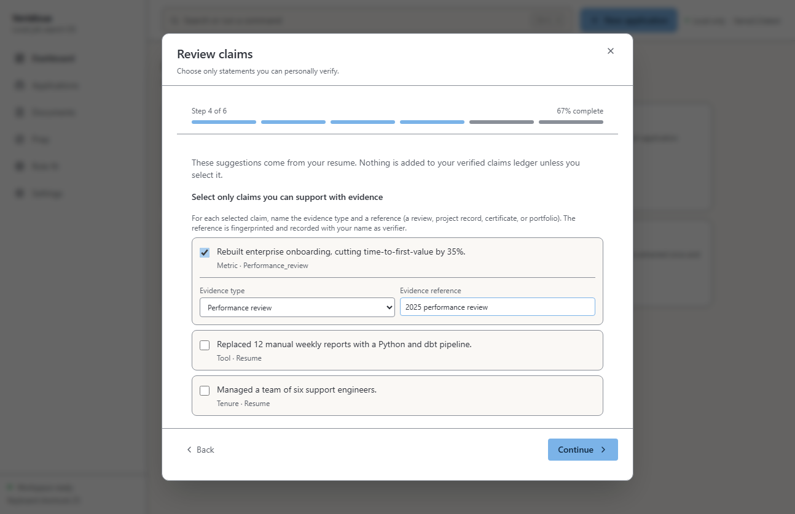
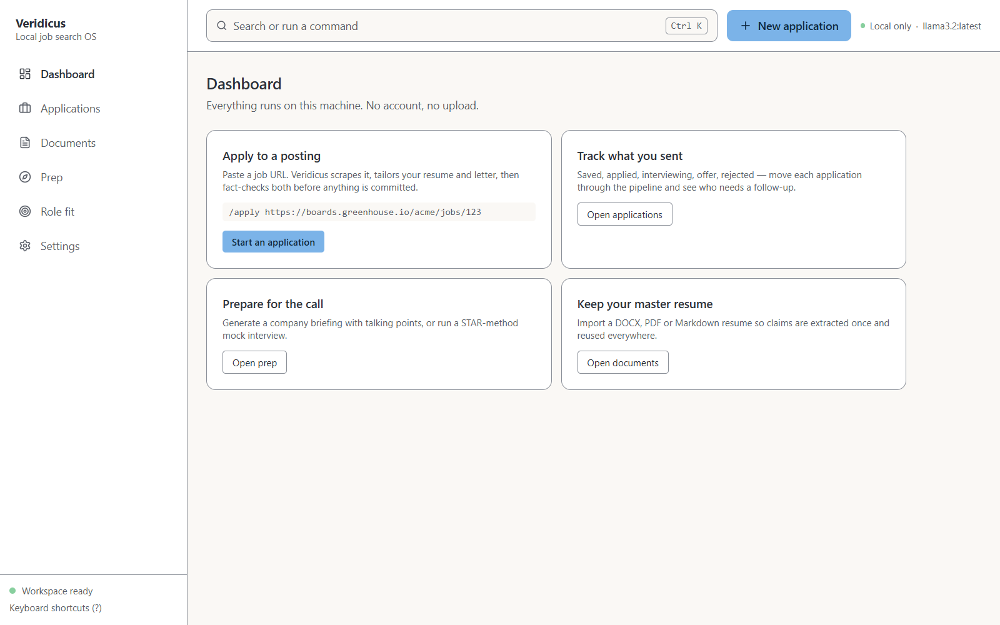

# Veridicus User Guide

## Getting Started

### Install Ollama

Veridicus runs every model locally through Ollama: there is no cloud account, API key or subscription. Install Ollama once, before the setup wizard asks which models to use.

- **Windows**: download `OllamaSetup.exe` from [ollama.com/download](https://ollama.com/download) and run it, or install from PowerShell with `irm https://ollama.com/install.ps1 | iex`. It installs in your user account, starts in the background, and serves the API on `http://localhost:11434`.
- **macOS**: download the app from [ollama.com/download](https://ollama.com/download) and drag it to Applications, or run `curl -fsSL https://ollama.com/install.sh | sh`. Open the app once so its background service starts.
- **Linux**: run `curl -fsSL https://ollama.com/install.sh | sh`, which installs and starts the service.

Confirm the install, then pull at least one model:

```
ollama --version
ollama pull llama3.2:3b
```

If Veridicus reports that Ollama is not responding, start the daemon with `ollama serve` (on Windows and macOS the desktop app normally starts it for you).

### Recommended Models

Veridicus uses two model roles, set in Ollama Settings: a **fast** model for short tasks (gap analysis, fact-check, bullet review) and a **deep** model for documents (`/apply`, `/prep`, `/mock`). Both should be instruction-tuned, because the app relies on the model following a fixed output shape and returning JSON for bullet review.

| Model | Pull | Size | Role |
| --- | --- | --- | --- |
| `llama3.2:3b` | `ollama pull llama3.2:3b` | 2.0 GB | Fast default; fits an 8 GB machine |
| `qwen3:8b` | `ollama pull qwen3:8b` | 5.2 GB | Fast, stronger at following instructions |
| `gemma4:12b` | `ollama pull gemma4:12b` | ~8 GB | Deep default on a 16 GB machine |
| `qwen3:14b` | `ollama pull qwen3:14b` | 9.3 GB | Deep alternative, 16 GB and up |

Sizing rule: keep the model file under roughly half your RAM and leave the rest for the context window. A document generation sends the base resume, the verified claims and the posting in one prompt, so Veridicus asks for a 24 576-token context by default; raise the context length in Ollama Settings for a long base resume. All four models above support a large enough context.

Avoid models below about 3B for documents, and avoid reasoning-only or uncensored fine-tunes: they tend to answer in commentary or refuse the required shape, which the guardrails reject after one retry. If a document fails on the same defect twice, try a larger deep model before editing your claims.

### First Launch
1. Launch Veridicus from your installed application
2. Complete the Setup Wizard:
   - **Welcome**: Introduction to Veridicus
   - **Profile**: Enter your name, contact info, and target roles
   - **Master Resume**: Upload or paste your resume
   - **Claims Verification**: Review and confirm extracted claims (these become your verified facts)
   - **Ollama Models**: Select models for fast and deep tasks



The Review claims step suggests statements taken from the resume you just pasted. Nothing enters the verified claims ledger until you tick it and name the evidence behind it, and a reference you give is fingerprinted with your name as verifier. Leaving every suggestion unchecked is a valid answer.

When the wizard finishes, Veridicus opens on the dashboard:



Each card opens the workflow it names, and the same commands can be run by name from the palette. The header shows which local model is loaded and whether the workspace is ready.

### Opening the Command Palette
Press Cmd+K (Mac) or Ctrl+K (Windows/Linux) to open the command palette, or click the \"Cmd+K\" button in the header.

## Workflow Order

### 1. Import Your Resume
Before applying to jobs, you need to import your resume and build your Claims Ledger.

**Option A: Dashboard Button**
- Click \"Open Resume File\" in the header
- Select your resume (PDF, DOCX, ODT, TXT, or MD)

**Option B: Command Palette**
`
/resume [filepath]
`
- If no filepath provided, a file dialog will open
- Claims are automatically extracted and saved to the encrypted ledger

### 2. Apply to a Job
The main workflow for applying to a job posting.

`
/apply <job-url>
`

**What it does:**
1. Scrapes the job description from the URL
2. Runs gap analysis against your Claims Ledger
3. Generates a tailored resume using only confirmed claims
4. Generates a first-person cover letter using only confirmed claims - five paragraphs, 350-480 words, with any required gap named plainly in its own paragraph
5. Runs fact-check pass to ensure no hallucinations
6. Compiles PDF using Typst
7. Performs visual QA on generated PDFs
8. Updates Application Ledger and commits to Git

**Example:**
`
/apply https://jobs.lever.co/company/abc123
`

### 3. Prepare for Interviews
Research a company before your interview.

`
/prep <company-name>
`

**Example:**
`
/prep Acme Corp
`

Generates a company briefing with overview, recent news, culture, interview tips, and talking points.

### 4. Practice Interviews
Run a STAR-method interview simulator.

`
/mock <role>
`

**Example:**
`
/mock Senior Software Engineer
`

Starts a session, not a single prompt. The interviewer asks one question at a time from the grounded question bank and waits for your answer; type your answer and press Enter.

**Two modes.** `/mock <role>` is coaching mode: every answer is scored on relevance, structure, specificity and impact, with one thing to fix. Add `--simulation` to withhold all feedback until the end, the way a real interview runs.

`
/mock Director of Training --simulation
`

**During a session:**

`
/skip
` passes the current question,
`
/retry
` redoes the previous one, and
`
/end
` stops early and produces the debrief. Esc closes the palette and pauses the session; Ctrl+K resumes it where you stopped. A pause hint appears in the output the first time.

**The debrief** lists every question with its score, what worked, the fixes worth making first, delivery facts measured from your own answers (length, hedging, STAR coverage, whether you used a number), and what to rehearse next. It is also saved in the palette output for the rest of the app session.

**Drill the weak answers.** After a coaching run the debrief offers `Drill weak answers (n)`: up to three of your lowest-scoring questions, asked again, weakest first. Each round is compared with the best score that question has had, so a question leaves the drill only once you beat it; `Drill again` asks only the ones still behind. A three-question drill takes a couple of minutes and is the fastest way to move one specific answer. Drills need the per-answer scores a coaching run produces, so they are offered from a coaching run rather than a simulation.

The interview cannot start without confirmed claims: questions and coaching are grounded in the ledger, so the tool will not invent experience for you.

### 5. Follow Up on Applications
Pick who to follow up with, then draft one email.

`/followup` lists applications marked SUBMITTED or INTERVIEWING that were applied to in the last 21 days, newest first. `/followup 2` drafts the second one, `/followup Acme` drafts the one matching that company (searched over 90 days), and `/followup 45` widens the window to 45 days. When the window holds nothing, it says so and names the most recent application and its age rather than returning an empty list.

### 6. Weekly Report
Generate a summary of your job search activity.

`
/weekly
`

Shows total applications, submitted, interviewing, rejected, and offers.

### 7. Log Analysis
Analyze your daily logs and application counts.

`
/logs
`

Shows today's applications, past 7 days, and daily log contents.

## Additional Features

### Application Ledger
Click \"Application Ledger\" in the header to view all applications with their status, employer, role, and dates. You can update application status from this view.

### Export Resume
Click \"Export Resume\" to export your resume in ATS-optimized format (PDF, DOCX, or ODT).

### Ollama Settings
Click \"Ollama Settings\" to:
- View installed models
- Configure fast model (quick tasks) and deep model (complex tasks like /apply)
- Download new models from Ollama

### Honesty Record (Settings)

Settings -> Honesty record shows blocking findings, overrides, advisory findings, false-block reports and when the next review is due, and lets you record a review. `/honesty-stats` prints the same summary in the palette.

### Completion Sound (Settings)

Settings -> Completion sound plays a short chime when a run takes longer than eight seconds and Veridicus is in the background. Failures use a lower tone, cancelled runs and short commands stay silent, and the mock interview chimes when a session ends regardless of how long it ran. Choose Off, Background (default) or Always.

Settings -> Desktop notifications shows the same runs as a Windows toast, so a long run is visible when you are in another window. The toggle is the consent step: turning it on asks Windows once, and if permission is refused it switches back and points at Settings -> System -> Notifications -> Veridicus. Toast text names only the operation ("Cover letter finished."), never an employer, a role or document text, because notifications stay in the Action Center. Windows Focus Assist and the per-app notification switch can still hide them silently; the chime is the fallback. Toasts only work in the installed app — a `tauri dev` build has no Start-menu shortcut, so Windows may drop them.

## Compliance and evidence

Veridicus is built so the honesty guardrails can be inspected rather than trusted: every application leaves a record of what was generated, what was checked, what the gate decided, and what you approved. The design is informed by **NIST AI RMF 1.0** and its Generative AI Profile (**NIST AI 600-1**), and by **ISO/IEC 42001:2023**, with ISO/IEC 23894 and ISO/IEC 42005 as guidance.

This is alignment evidence, not certification. NIST AI RMF is voluntary, and ISO/IEC 42001 certifies an organization's AI management system rather than an application. The repository's policy, roles, objectives, impact assessment and Statement of Applicability are drafts awaiting signature, and the audit programme has not been run. The evidence index is `docs/COMPLIANCE-EVIDENCE.md`; applicability and the three exclusions are in `docs/STATEMENT-OF-APPLICABILITY.md`.

### What each application records

Every application folder gets an append-only audit file, `audit/events.jsonl`, with four event types: `generated`, `disclosure_acknowledged`, `approved` and `override`. Each event carries the event id, UTC timestamp, app version and application id; the generation and commit events also carry:

- the model name and digest, including the digest at commit time
- the prompt template version, rule ids and the rule-set SHA-256
- the SHA-256 and byte size of `resume.md` and `cover-letter.md`
- the blocking verdict, every finding, and the advisory count
- the written override reason when you override a block

`guardrail-report-commit.json` holds the commit-time re-check and never overwrites the apply-time report, so you can see whether the rules or the documents changed between generation and approval.

### How the standards map to features

| Anchor | What Veridicus does | Where |
| --- | --- | --- |
| NIST MEASURE 2.8, ISO/IEC 42001 A.6.2.8 - event logs | Append-only per-application events with model, rule-set and document hashes | `applications/<id>/audit/events.jsonl` |
| NIST MEASURE 2.1/2.3, ISO A.6.2.4 - verification and validation | Adversarial fixtures for fabricated metrics, dropped qualifiers, scope escalation, never-claim subjects, omitted gaps, ungrounded bullets, employer mismatch and prompt injection, run on every `cargo test` | `src-tauri/eval/guardrails.json` |
| ISO A.8.2 - information for users | First-run and per-application AI-assisted disclosure; the per-application acknowledgement is required before a commit | Start-up dialog, review dialog |
| ISO A.6.2.6 - operation and monitoring | `/honesty-stats` and Settings -> Honesty record: generations, approvals, overrides and override rate, blocking and advisory findings by code, false-block reports, and the next review date | `/honesty-stats` |
| ISO 9.1, 9.3 - measurement and review (self-review) | Recording a review writes reviewer, note and counts to `compliance/reviews.jsonl` and restarts the 90-day cadence | Settings -> Honesty record -> Record review |
| ISO A.3.3, A.8.4 - concerns and incidents | Report a problem with an output; each report gets an incident id and status, and the log exports as CSV | Application review dialog |
| ISO A.7.5 - data provenance | Claims carry evidence type, reference, SHA-256 fingerprint, verifier and confirmation time; weak provenance raises an advisory finding | Claims ledger and setup |
| ISO A.6.1.3, A.9.2 - responsible use | Deterministic checks decide and can block; the model's advisory scope pass can warn but never block; an override is evidence, not a pass | Guardrail report in the application view |
| ISO A.6.2.2 - requirements | The posting is delimited and labelled as data; instruction-like text is detected, warned about and noted | Findings and audit record |

### The commit gate

Generation never commits by itself. When you approve an application, Veridicus re-reads the rendered files, re-runs the deterministic checks against the current rules and claims, and writes the commit-time report. A blocking finding stops the commit. An override requires a written reason, is stored in `guardrail-override.md`, is appended to the application notes and is recorded as an `override` event.

### What the record cannot do

- It is local and unsigned. Anyone with file access can edit it; Git history makes casual alteration visible, but the record is not tamper-proof.
- It is not an audit. No independent internal audit or management review has been performed, and no baseline has been measured for the honesty objectives.
- Rule changes are detectable through the rule-set hash, but the previous rule text is not retained.
- The advisory model pass is best-effort and can miss paraphrased scope inflation. The deterministic gate is the authority, and it is not a truth oracle.
- Veridicus does not submit applications and cannot retract one. Recourse after submission depends on the employer and on your own process.

### Producing evidence for one run

1. Run `/apply` for a posting.
2. Open the application folder and read `audit/events.jsonl`. The `generated` event shows the model digest, template version, rule ids and hash, document hashes, findings and the blocking verdict.
3. Acknowledge the per-application disclosure in the review dialog; this appends `disclosure_acknowledged`.
4. Approve, or record an override with a written reason.
5. Run `/honesty-stats`.
6. Record a review in Settings so the cadence is dated.
7. Export incidents as CSV if you reported any.
8. Run `cargo test` to repeat the fixture evaluation.
9. For a full audit, follow `docs/INTERNAL-AUDIT.md` and the workpapers in `docs/audit/`.

## Tips

- **Be honest**: Only claims in your ledger are used. If a required skill isn't there, it won't be added
- **Keep Ollama running**: Veridicus requires Ollama to be running locally
- **Use the ledger**: Track all applications in the Application Ledger
- **Git history**: All /apply runs are automatically committed to Git in your Veridicus workspace

## Troubleshooting

- **Ollama not responding**: Ensure Ollama is running (ollama serve) and the model is loaded
- **Resume import fails**: Check file format (PDF, DOCX, ODT, TXT, MD supported)
- **/apply fails**: Ensure resume is imported, claims are verified, and Ollama model is configured
- **PDF generation fails**: Check that Typst sidecar is present
