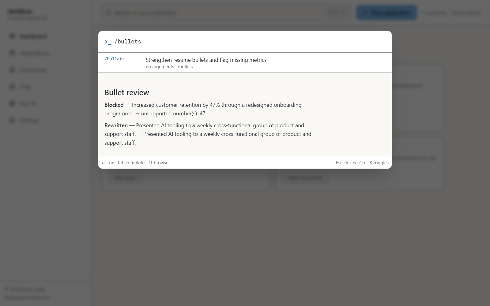

Veridicus is a Windows desktop application for a job search that will not state what you cannot verify. Every generated sentence is grounded in a claims ledger of confirmed facts, and a model that invents, pads or contradicts the ledger is rejected and retried rather than shipped. Inference runs locally through Ollama, so resumes and job descriptions never leave the machine.

- [Source repository](https://github.com/RadioMan18/Veridicus)
- [Latest release and installers](https://github.com/RadioMan18/Veridicus/releases/latest)
- [User guide](https://github.com/RadioMan18/Veridicus/blob/main/USER_GUIDE.md)
- [Changelog](https://github.com/RadioMan18/Veridicus/blob/main/CHANGELOG.md)

## Guardrails in action

`/bullets` drafts a stronger version of each resume bullet from your confirmed claims, then re-checks the draft before showing it. Here the first bullet keeps a 47% figure that nothing in the ledger supports, so it is blocked and the offending number is named; the second is grounded and comes back rewritten.

## Compliance and standards evidence

The design is informed by **NIST AI RMF 1.0** and its Generative AI Profile (**NIST AI 600-1**), and by **ISO/IEC 42001:2023**, with ISO/IEC 23894 and ISO/IEC 42005 as guidance.

This is **alignment evidence, not certification**. NIST AI RMF is voluntary, and ISO/IEC 42001 certifies an organization's AI management system rather than an application. The policy, RACI, objectives, impact assessment and Statement of Applicability are drafts awaiting signature, and no internal audit or management review has been performed.

| Document | What it covers |
| --- | --- |
| [COMPLIANCE-EVIDENCE.md](COMPLIANCE-EVIDENCE.md) | Index mapping selected controls to the artifact or code path that evidences them |
| [STATEMENT-OF-APPLICABILITY.md](STATEMENT-OF-APPLICABILITY.md) | All 38 Annex A controls: 35 selected, 3 excluded with reasons, plus clause-level evidence |
| [GUARDRAIL-METHOD.md](GUARDRAIL-METHOD.md) | The deterministic checks, the advisory scope pass, the commit gate and the audit record |
| [AI-SYSTEM-CARD.md](AI-SYSTEM-CARD.md) | Purpose, behaviour, data, limits and disclosure |
| [AI-POLICY.md](AI-POLICY.md) | Intended and prohibited use, human oversight, review triggers |
| [AI-IMPACT-ASSESSMENT.md](AI-IMPACT-ASSESSMENT.md) | Affected groups, impacts and treatments |
| [AI-RACI.md](AI-RACI.md) | Roles, decision rights and the independence limitation |
| [HONESTY-OBJECTIVES.md](HONESTY-OBJECTIVES.md) | Measurable objectives, denominators, cadence and corrective action |
| [CONCERNS-CHANNEL.md](CONCERNS-CHANNEL.md) | Intake, triage, confidentiality, non-retaliation and appeal |
| [INTERNAL-AUDIT.md](INTERNAL-AUDIT.md) | Audit programme and workpapers — procedures that have not yet been operated |
| [MANAGEMENT-REVIEW.md](MANAGEMENT-REVIEW.md) | Management review record and cadence |
| [OPERATOR-ADOPTION-CHECKLIST.md](OPERATOR-ADOPTION-CHECKLIST.md) | The role, contact, review and signature record an operator must complete |
| [audit/README.md](audit/README.md) | Workpapers, evidence manifest and sign-off |

The limitations are part of the record: it is local and unsigned, rule changes are detectable only by hash, the advisory model pass can miss paraphrased scope inflation, and no honesty objective has a measured baseline yet.

## What these pages are

These pages are built from the `docs/` folder of the repository, so the documents read the same way here and in the source. Links back into the repository — the user guide, the changelog, the installers — open on GitHub.
